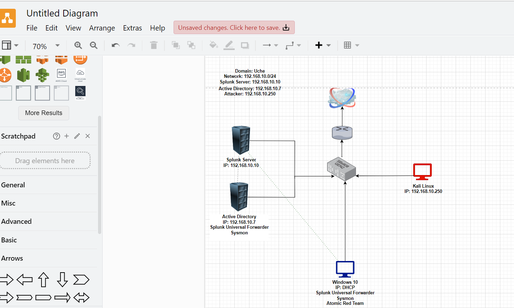
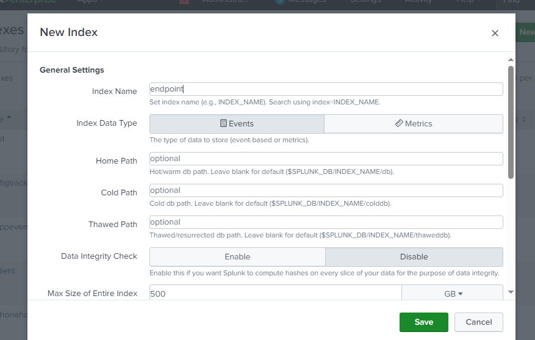
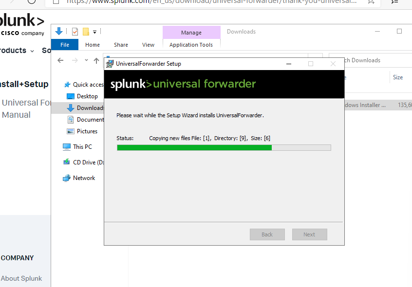
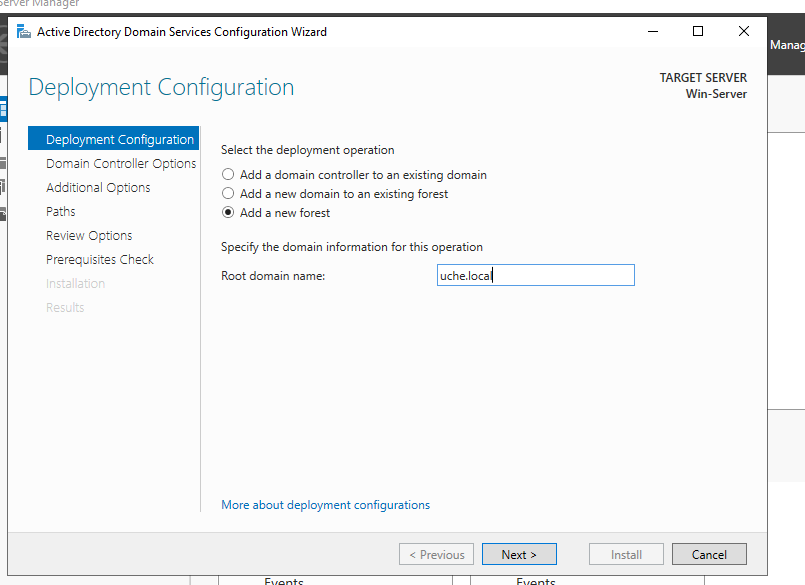
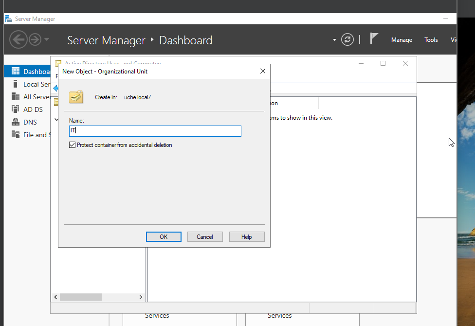
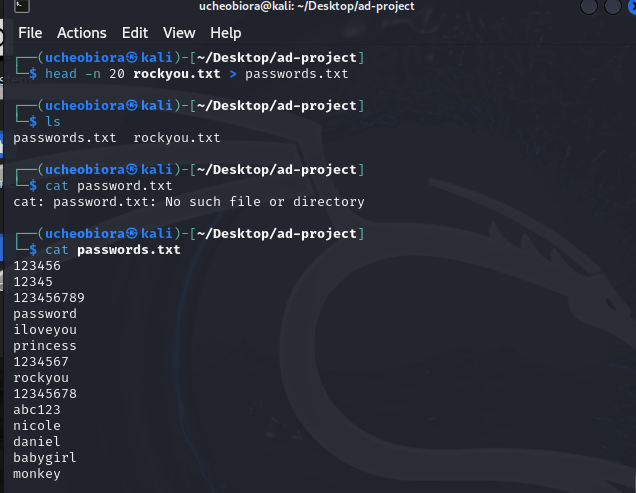
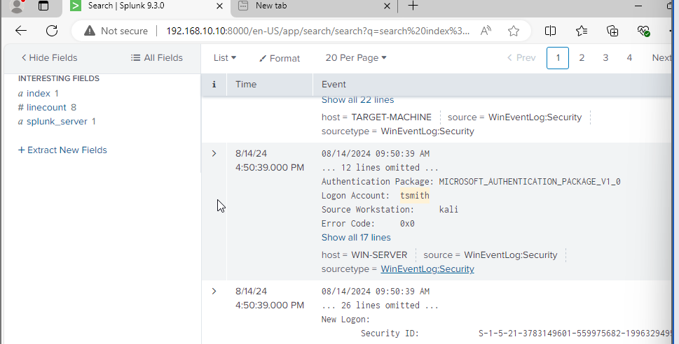
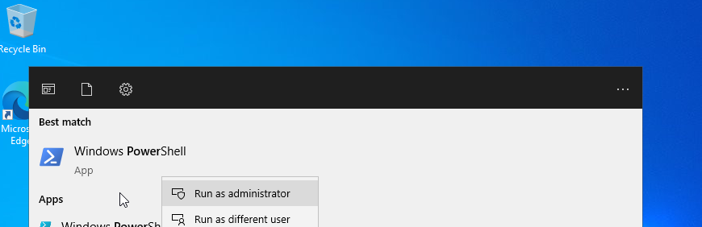

# 🔍 Active Directory SOC Lab: Detecting Attacks with Splunk & Sysmon


I built a small enterprise network from scratch: an **Active Directory domain**, a **Splunk SIEM** fed by **Sysmon** and Windows Event Logs, and a **Kali Linux attacker**. Then I attacked it and investigated the results like a SOC analyst would.

## 🎯 Objectives

- Design and deploy a realistic Windows domain environment
- Centralize endpoint telemetry (Windows Event Logs + Sysmon) into Splunk
- Simulate real attacker behavior: an **RDP brute-force attack** and **MITRE ATT&CK techniques with Atomic Red Team**
- Detect and triage the activity in Splunk

## 🗺️ Architecture

| Host | Role | IP |
|---|---|---|
| Ubuntu Server | Splunk Enterprise (SIEM) | `192.168.10.10` |
| Windows Server | AD Domain Controller + Splunk Universal Forwarder + Sysmon | `192.168.10.7` |
| Windows 10 | Domain-joined target + Universal Forwarder + Sysmon + Atomic Red Team | DHCP |
| Kali Linux | Attacker | `192.168.10.250` |

All VMs share an isolated VirtualBox NAT network (`192.168.10.0/24`).



## 🛠️ What I Built

1. **Planned the network.** I drew a logical diagram with a consistent IP scheme before building anything.
2. **Deployed the SIEM.** I installed Splunk Enterprise on Ubuntu, enabled it at boot, created an `endpoint` index, and opened receiving port `9997`.
   
3. **Onboarded endpoint telemetry.** I installed the Splunk Universal Forwarder and Sysmon (with the [sysmon-modular](https://github.com/olafhartong/sysmon-modular) config) on both Windows hosts, then wrote an `inputs.conf` that ships Application, Security, System, and Sysmon logs:
   ```ini
   [WinEventLog://Security]
   index = endpoint
   disabled = false

   [WinEventLog://Microsoft-Windows-Sysmon/Operational]
   index = endpoint
   disabled = false
   renderXml = true
   source = XmlWinEventLog:Microsoft-Windows-Sysmon/Operational
   ```
   
4. **Stood up Active Directory.** I installed AD DS, promoted the server to a Domain Controller in a new forest, created OUs (IT, HR), added users, and joined the Windows 10 machine to the domain.
   
   

## ⚔️ Attack Simulation & Detection

### 1. RDP Brute Force (Kali → Target)
I used **Crowbar** with a wordlist built from `rockyou.txt` to brute-force RDP logins for domain users.



**Detection:** In Splunk, I searched the `endpoint` index for the targeted account. The resulting Windows Security authentication events showed a burst of activity within the same second, with the source workstation `kali`. That pinpointed the attacking host and the account it hit.



### 2. Adversary Emulation with Atomic Red Team
I installed **Atomic Red Team** on the target and ran MITRE ATT&CK techniques from PowerShell. Then I checked whether each one generated Sysmon/Windows telemetry in Splunk. That shows where detection coverage has gaps.



## 📚 Key Takeaways

- Built an end-to-end log pipeline from endpoint to SIEM and troubleshot forwarder, service-account, and indexing issues
- Learned how brute-force attacks surface in Windows Security logs and how to pivot on source host and account
- Used adversary emulation to measure **detection coverage** against MITRE ATT&CK, not just "is it logging"

## 📄 Full Guide

The complete step-by-step guide with **100+ screenshots** is in this repo:
- [`Active Direcrory Project.guide (with Pictures)`](<Active Direcrory Project.guide (with Pictures)>) (Word document, download to view)
- [`Active_Directory_Project (my guide).docx`](<Active_Directory_Project (my guide).docx>) (condensed version)
